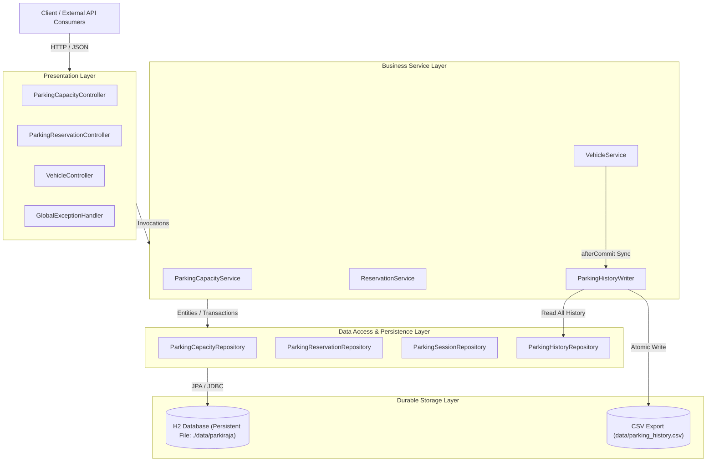
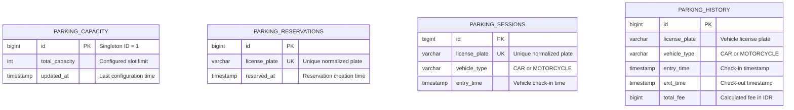
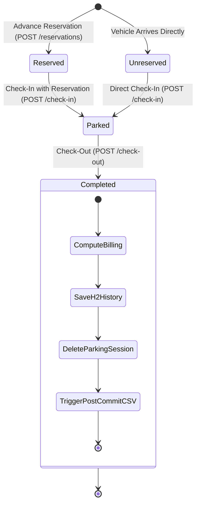

# ParKing Architecture & Technical Design

This document describes the architectural principles, domain model, persistence strategy, concurrency control, and lifecycle design of the **ParKing** (ParkiRaja) parking management service.

---

## 1. Architectural Overview

ParKing is built on a clean, layered architecture leveraging Spring Boot, Spring Data JPA, and Jakarta Bean Validation. The system maintains strict separation of concerns across controllers, services, repositories, and persistence mechanisms.



---

## 2. Domain Model & Entity Relationships

The domain consists of four primary persistent entities managed by Spring Data JPA / Hibernate:

1. **`ParkingCapacity`**: Singleton configuration entity storing the maximum allowable concurrent occupancy (`totalCapacity`).
2. **`ParkingReservation`**: Ephemeral reservation entity holding a guaranteed slot for a specific license plate.
3. **`ParkingSession`**: Active parking session tracking entry timestamp and vehicle type for a parked vehicle.
4. **`ParkingHistory`**: Append-only audit record of completed parking sessions including entry, exit, duration, and calculated fee.



---

## 3. Vehicle & Parking Lifecycle

A vehicle interacts with the system through distinct lifecycle transitions:



### Lifecycle Transition Details
1. **Reservation**:
   - Acquires a pessimistic write lock on `ParkingCapacity`.
   - Checks if `(activeVehicles + activeReservations) < totalCapacity`.
   - Verifies the vehicle is neither currently parked nor already reserved.
   - Persists a new `ParkingReservation` record.
2. **Check-In**:
   - Acquires a pessimistic write lock on `ParkingCapacity`.
   - Verifies the vehicle is not already parked.
   - If a matching reservation exists: deletes the reservation and creates `ParkingSession` (occupancy remains constant).
   - If no reservation exists: checks `(activeVehicles + activeReservations) < totalCapacity`, then creates `ParkingSession`.
3. **Check-Out**:
   - Finds active `ParkingSession` by normalized license plate.
   - Computes billable duration using ceiling rounding:
     $$\text{durationHours} = \left\lfloor \frac{\text{seconds} + 3599}{3600} \right\rfloor$$
   - Multiplies duration by vehicle type hourly rate (Car: IDR 5,000 / Motorcycle: IDR 3,000).
   - Inserts `ParkingHistory` record into H2.
   - Deletes active `ParkingSession` record.
   - Schedules post-commit CSV synchronization hook (`TransactionSynchronization.afterCommit()`).

---

## 4. Concurrency Control & Race Condition Mitigation

The system guarantees consistency under concurrent load using multiple defensive techniques:

### 4.1 Pessimistic Database Locking
When modifying capacity, creating reservations, or checking in vehicles, services obtain an exclusive database row lock on the singleton capacity record:

```java
@Lock(LockModeType.PESSIMISTIC_WRITE)
@Query("SELECT pc FROM ParkingCapacity pc WHERE pc.id = :id")
Optional<ParkingCapacity> findByIdForUpdate(@Param("id") Long id);
```

- **Guaranteed Capacity Invariant**: Prevents two simultaneous check-ins or reservations from both seeing 1 remaining slot and exceeding the limit.
- **Ordered Execution**: Competing requests queue at the database level for the row lock, ensuring strictly serialized capacity checks.

### 4.2 Database Unique Constraints
Both `ParkingSession` and `ParkingReservation` enforce database-level unique constraints on `license_plate`:

- Prevents duplicate active parking sessions for the same vehicle even under concurrent check-in requests.
- Intercepted by `GlobalExceptionHandler` via `DataIntegrityViolationException`, returning a clean `409 Conflict`.

---

## 5. Dual-Storage Architecture: H2 Database vs CSV Export

A critical architectural requirement is preserving both **durable H2 relational persistence** and **external CSV reporting**.

### 5.1 Authoritative Source of Truth: H2 Database
- The H2 relational database (`./data/parkiraja.mv.db`) is the durable, ACID-compliant primary source of truth.
- All session states, reservations, capacity settings, and finalized parking histories are recorded directly in H2 tables.
- Foreign keys, transactions, and row-level locks maintain transactional consistency.

### 5.2 Post-Commit CSV Synchronization
To decouple business transactions from filesystem latency and avoid partial file corruption, CSV export operates via Spring's `TransactionSynchronization`:

1. Vehicle checkout completes all database mutations (history insert + session delete) inside a Spring `@Transactional` boundary.
2. A post-commit hook is registered:
   ```java
   TransactionSynchronizationManager.registerSynchronization(new TransactionSynchronization() {
       @Override
       public void afterCommit() {
           parkingHistoryWriter.syncFromDatabase();
       }
   });
   ```
3. Once the database transaction has successfully committed, `ParkingHistoryWriter.syncFromDatabase()` executes.
4. It reads all committed history records ordered by `id ASC` using an independent read transaction (`Propagation.REQUIRES_NEW`), formats them according to RFC 4180 with CSV formula injection defense, and writes the complete file atomically.

### 5.3 Fault Isolation & Resilience
- **Filesystem Error Isolation**: If writing to `data/parking_history.csv` fails (due to disk full, file permissions, or OS locks), the exception is caught and logged via SLF4J.
- **Client Safety**: The checkout transaction does NOT roll back, and the client receives a valid `200 OK` response. The billing and exit are already permanent in H2.
- **Self-Healing on Subsequent Checkout**: Because the CSV is regenerated from the complete database history, the very next checkout will write all records including any previously skipped.
- **Startup Recovery (`ApplicationReadyEvent`)**:
  When the application starts, `ParkingHistoryWriter.onApplicationReady()` automatically runs `syncFromDatabase()`. If the CSV file was deleted, corrupted, or outdated while the service was stopped, it is immediately rebuilt from H2.
